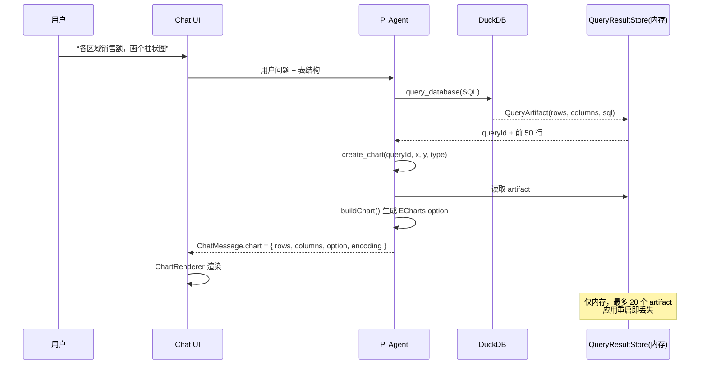
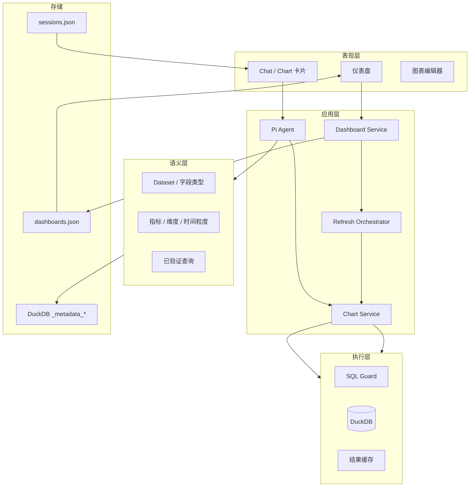
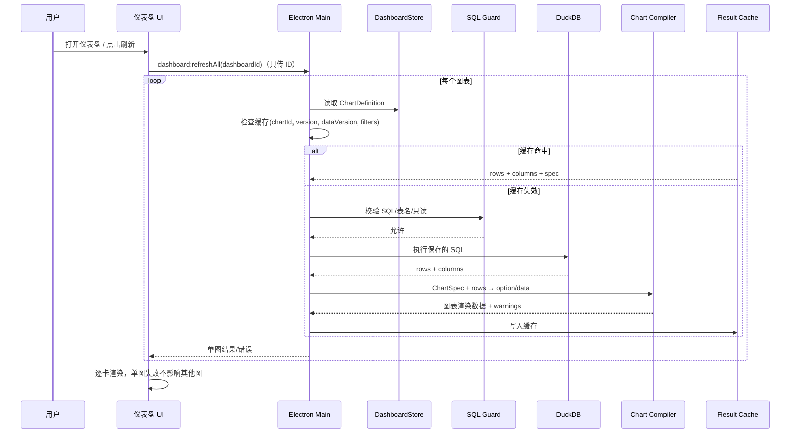

# Chat2Excel 图表能力与仪表盘改造调研

> 调研日期：2026-10-25  
> 范围：现有图表/查询链路、主流开源 ChatBI 架构、Chart2Excel 的仪表盘与订阅方案  
> 说明：你提到的“circle 的元数据”，本文按“图表/查询元数据”理解，即持久化 SQL（或语义查询）与图表编码配置，而不是保存渲染后的图片或 ECharts option。如果 circle 指某个具体组件，请补充，我再校准。

---

## 0. 结论摘要

先给结论：

1. **当前实现不是主流的“可刷新 ChartBI”模式。** 现在是每次提问让模型重新写 SQL、重新选图，图表是 `queryId` 对应的一次性查询产物；查询结果只存在内存里，最多 20 个 artifact，应用重启或淘汰后就无法复现。
2. **主流 ChatBI 的核心不是“让 AI 每次重新画图”，而是把链路拆成两段：**
   - **创作时**：自然语言 → 语义查询/受控 SQL → AI 选择图表编码 → 用户确认；
   - **消费时**：仪表盘只回放已保存的查询和图表规格，**不再调用 LLM**。
3. **要实现“订阅图表 → 放入仪表盘 → 数据更新后刷新”，最小的必要改造是：**
   - 把图表从聊天消息里的 `rows + option` 变成一个独立的、可持久化的 `ChartDefinition`（查询 + 图表规格 + 数据源绑定 + 刷新策略）；
   - 新增 `Dashboard` 对象，仪表盘通过 `chartId` 引用图表，不复制行数据；
   - 刷新时由主进程重新执行保存的 SQL，再用同一个 ChartSpec 编译器重建图表；
   - 解决当前“导入文件生成随机物理表名”的问题，否则重新导入后保存的 SQL 会失效。
4. **语义层是第二阶段，不是第一阶段的阻塞项。** 先用“保存 SQL + ChartSpec”把可刷新闭环做出来；随后再补指标/维度/同义词/已验证查询，把准确率和治理能力提升到主流 ChatBI 的水平。
5. **图表渲染不要继续扩展手写 ECharts option。** 建议定义一个较小的声明式 `ChartSpec`，由编译器统一生成 ECharts option；如果希望快速获得 30+ 图表类型，可以评估 Microsoft 的 Flint（MIT，支持 ECharts 后端）。

一句话概括目标形态：

> **聊天负责“发现和创作”，仪表盘负责“保存和刷新”；AI 只参与创作，刷新完全确定性执行。**

---

## 1. 当前实现盘点

### 1.1 现有链路



关键代码：

| 位置 | 当前行为 |
| --- | --- |
| `electron/agent/tools.ts` `create_chart` | 模型只能传 `queryId + chartType + x/y/series`，不能手写图表数据，这一点做得对 |
| `electron/agent/chart.ts` | 从 `QueryArtifact` 的真实行构建 ECharts option；支持 bar/line/area/pie/scatter |
| `electron/agent/result-store.ts` | 查询结果只存在内存，最多 20 个 artifact，单 artifact 最多 20 万行 |
| `electron/agent/runtime.ts` | 把 `chart`（含 rows 和 option）直接塞进 `ChatMessage`，随后随会话持久化 |
| `electron/session.ts` | 会话存到 `sessions.json`，没有图表/仪表盘对象 |
| `electron/db.ts` | 导入时生成 `base_timestamp_salt` 随机物理表名；元数据只保存表/列描述 |
| `src/components/chat/message-list.tsx` | 图表卡片只有“下载图片 / 导出 Excel”，没有“订阅到仪表盘” |
| `src/App.tsx` | 一级导航只有数据、对话、Agents、设置，没有仪表盘 |
| `src/lib/agent/message.ts` | `ChartData` 直接带 `rows` 和 `option`，是聊天消息的一部分 |

### 1.2 做得好的地方

这几点应该保留，不要推倒重来：

- **图表数据来自真实查询结果**，模型只选择编码，不生成 ECharts JSON。这避免了“图表和 SQL 讲两个故事”的常见问题。
- **SQL 只读守卫**比较完整：解析 AST、限制单条 SELECT、禁止表函数/文件函数/系统函数，刷新时应继续复用。
- **表/列描述**已经存在，这是语义层的雏形，可以平滑扩展成指标/维度。
- **本地优先**：DuckDB + Electron 主进程执行，数据不出本机，适合财务、人事等敏感场景。

### 1.3 与目标的差距

| 能力 | 当前 | 目标 | 影响 |
| --- | --- | --- | --- |
| 图表持久化 | 只存在于聊天消息，含 rows/option | 独立 `ChartDefinition`，可复用 | 无法订阅、无法跨会话复用 |
| 仪表盘 | 无 | 独立菜单、列表、网格布局 | 用户没有“长期看板” |
| 刷新 | 无；重新提问让 AI 再生成 | 回放 SQL + ChartSpec，不调用 LLM | 结果不稳定、成本高、慢 |
| 语义层 | 只有表/列描述 | 指标、维度、时间粒度、同义词、已验证查询 | 模型仍要每次猜 SQL |
| 图表类型 | 5 种 | 15+ 种业务常用图 | 很多场景只能退回表格 |
| 图表格式 | 基础坐标轴/图例 | 数字/日期/百分比格式、堆叠、TopN、KPI、组合图 | 不像 BI 成品 |
| 数据身份 | 随机物理表名 | 稳定数据集 ID + 可替换导入 | 重新导入后 SQL 失效 |
| 缓存 | 内存 20 个 artifact | 按图表/数据版本缓存 + TTL | 仪表盘刷新慢、重复查询 |
| 可追溯 | 只有 queryId | 图表版本、来源会话、最后刷新状态 | 出错难排查 |

### 1.4 两个必须先解决的结构性问题

**问题一：物理表名不稳定。**

`electron/db.ts` 导入时用 `baseName + timestamp + salt` 生成物理表名。用户把更新后的 Excel 再导入一次，会得到一张新表；旧仪表盘保存的 SQL 仍然指向旧表，因此刷新出来的是旧数据，或者直接报表不存在。

**问题二：会话里保存了图表数据本身。**

`ChatMessage.chart` 含 `rows` 和完整 ECharts `option`。这会导致：

- `sessions.json` 越来越大；
- 数据更新后，旧会话里的图表仍然是旧数据；
- 图表无法脱离某条消息独立存在；
- `option` 是渲染层产物，不是可编辑、可校验的元数据。

这两个问题不解决，仪表盘只能做成“截图墙”，无法真正刷新。

---

## 2. 主流开源 ChatBI 调研

### 2.1 三种主流路线

| 路线 | 代表项目 | 特点 | 适合场景 |
| --- | --- | --- | --- |
| **Text2SQL + RAG** | Vanna、DB-GPT、Chat2DB | 把 DDL、文档、历史 SQL 作为上下文，让模型直接写 SQL；灵活，但治理弱 | 探索式分析、SQL 熟练用户 |
| **语义层 + Chat** | WrenAI、SuperSonic、Cube | 先定义指标/维度/关系，自然语言映射到语义查询，再由编译器生成 SQL | 企业 BI、可刷新仪表盘、指标口径统一 |
| **BI 平台 + AI 助手** | Superset、Metabase | 图表/仪表盘元数据成熟，AI 是增强项 | 已有 BI 体系，想加自然语言入口 |

Chat2Excel 的目标用户是非技术业务人员，且要做“订阅到仪表盘 + 数据更新刷新”，**最应该借鉴的是第二类，辅以第一类的 RAG/已验证查询能力**。

### 2.2 项目拆解

#### WrenAI（Canner）

- GitHub：<https://github.com/Canner/WrenAI>（约 18k stars，2026-10）
- 核心是 **MDL（Modeling Definition Language）**：用可版本化的文件定义模型、列、关系、计算字段、视图、Cube（measures/dimensions/time dimensions/hierarchies）。
- 架构分四层：Agent workflow、Project context（MDL/instructions/profiles/memory）、Planning engine（sqlglot + CTE rewrite + wren-core）、Execution layer（connectors）。
- 正确性不是靠一个提示词，而是靠一组原语：schema linking、value profiling、歧义检测、generation trace、retry/repair、eval。
- 查询流程是“对 MDL 写 SQL → dry-plan/validate → 展开为物理 SQL → 执行”；MDL 是稳定接口，底层表结构变化不需要重写所有查询。
- 仪表盘：产品里可以把 thread 中生成的图表 pin 到 dashboard；当前 GenBI 方向还能由 agent 生成可分享的 dashboard app，支持 `snapshot`（把数据打包成 parquet/duckdb，完全无服务端）和 `live`（查看时回源仓库）两种数据模式。
- 可借鉴：
  - **语义契约与执行分离**：图表和仪表盘都建立在同一套语义定义上；
  - **已验证查询/记忆**：确认过的 NL→SQL 会回到 memory，作为后续 few-shot；
  - **snapshot/live 双模式**：很适合本地 Excel/CSV 场景，既能做“冻结报告”，也能做“实时刷新”；
  - **生成可追踪**：展示模型用了哪些表、哪些 join、最终 SQL。
- 不要照搬：MDL 和 Rust 引擎较重，Chat2Excel 现阶段不需要完整复刻；可以做一个 DuckDB 元数据版的“轻量语义层”。

#### SuperSonic（腾讯音乐）

- GitHub：<https://github.com/tencentmusic/supersonic>（约 5.1k stars，Apache-2.0）
- 明确把 **Chat BI + Headless BI** 融合：Chat BI 用 LLM，Headless BI 用语义层；语义层定义指标/维度/实体/标签及其业务含义和关系。
- 核心组件：
  - Knowledge Base：从语义模型提取 schema 信息，构建词典和索引；
  - Schema Mapper：把自然语言中的词映射到指标/维度/实体/值；
  - Semantic Parser：生成语义查询语句 **S2SQL**；
  - Semantic Corrector：校验/修正 S2SQL；
  - Semantic Translator：把 S2SQL 翻译成物理 SQL；
  - Chat Memory：历史查询轨迹作为 few-shot；
  - 三级权限：数据集、列、行。
- 关键思想：**LLM 不直接写复杂 SQL，而是写语义查询；join、公式等复杂 SQL 由语义层生成。** 这样既减少幻觉，也降低模型负担。
- 可借鉴：
  - 仪表盘应保存 **语义查询**（metrics/dimensions/filters/time range），而不是只保存一段脆弱的 SQL；
  - 语义修正器/校验器是必要的，不能完全信任 LLM 输出；
  - 查询历史可以变成 few-shot，越用越准；
  - 权限模型可以后置，但数据模型要预留 owner/ACL 字段。

#### Vanna

- GitHub：<https://github.com/vanna-ai/vanna>（约 24k stars，MIT；仓库当前显示已归档，2026-10）
- 典型 RAG 路线：训练数据包括 DDL、文档、SQL 示例；检索相关上下文后让 LLM 生成 SQL；运行时以流式方式返回表格、Plotly 图表和自然语言总结。
- Vanna 2.0 强调 user-aware、行级权限、审计、限流，并提供 `<vanna-chat>` Web Component。
- 局限：它主要解决“生成 SQL 和即时展示”，并没有把指标语义、图表规格、仪表盘刷新做成强契约；图表是运行时产物。
- 可借鉴：
  - 把“用户确认过的查询”沉淀为训练/检索样本；
  - 把权限和审计贯穿工具层，而不是只在 UI 层；
  - 图表/表格作为结构化流式组件返回，而不是让模型输出一大段 HTML。
- 不要照搬：纯 RAG 不能保证同一问题每次得到同样口径，不适合作为仪表盘的唯一基础。

#### DB-GPT

- GitHub：<https://github.com/eosphoros-ai/DB-GPT>（约 20k stars，MIT）
- 定位是 Agentic AI 数据分析助手：连接数据库/CSV/Excel/知识库，自主写 SQL 和 Python，在沙箱执行 skills，生成图表、Dashboard、HTML 报告和分析结论。
- 架构上强调 agents、AWEL 工作流、RAG、多模型、沙箱执行。
- 可借鉴：
  - Agent 可以做任务规划、多步分析、代码执行，适合“探索”而不是“固定报表”；
  - Skills 机制可以沉淀领域分析方法；
  - 报告/仪表盘生成可以作为 Agent 的产物。
- 不要照搬：它的强项是开放式 agentic 分析，仪表盘刷新仍然需要把查询和图表规格固化下来，否则每次都要重新规划。

#### Cube

- GitHub：<https://github.com/cube-js/cube>（约 21k stars，Apache-2.0 / MIT）
- Headless 语义层：在代码中定义 metrics、dimensions、joins、access rules，通过 SQL/REST/GraphQL 暴露给 BI、应用和 AI agent；内置关系型缓存引擎，支持 pre-aggregations。
- 可借鉴：
  - **指标定义一次，多处复用**；
  - **预聚合/缓存**：仪表盘不应该每次打开都扫全表；
  - **语义层不绑定 UI**，图表、聊天、导出都消费同一套指标。
- 不要照搬：Cube 是独立服务，Chat2Excel 是本地 Electron，直接引入成本高；可以借鉴它的“measures/dimensions/cache”模型。

#### Apache Superset

- GitHub：<https://github.com/apache/superset>（约 75k stars，Apache-2.0）
- 图表 `Slice` 的关键字段：`datasource_type/datasource_id`、`viz_type`、`params`、`query_context`、`cache_timeout`。
- `query_context` 被明确标注为 **cached/regenerated field, not user-authored**：它是执行层缓存，不是用户编辑的源数据；用户编辑的是 `params` 和 `viz_type`。
- 仪表盘 `Dashboard` 保存 `position_json`（布局）、`json_metadata`（筛选器等），通过多对多关联 `slices` 引用图表；图表本身是独立对象。
- 可借鉴：
  - **“作者元数据”和“执行产物”分离**：保存 `params/spec`，把 `query_context/option/rows` 当缓存；
  - **仪表盘引用图表，而不是内嵌图表**；
  - **布局与图表解耦**：`position_json` 单独存；
  - **缓存超时**：`cache_timeout` 是图表级配置。
- 这几乎就是 Chat2Excel 应该采用的数据模型。

#### Metabase

- GitHub：<https://github.com/metabase/metabase>（约 50k stars，AGPL/商业双许可）
- 仪表盘支持自动刷新（auto-refresh）和订阅（scheduled email/Slack reports）；“保存问题 → 放入仪表盘 → 定时/自动刷新”的产品路径非常成熟。
- 可借鉴：
  - 把“订阅到仪表盘”和“定时推送”区分开：前者是 pin，后者是 subscription；
  - 仪表盘打开时自动刷新、可配置刷新间隔；
  - 面向业务用户的空状态、错误提示、筛选器交互。
- 注意：AGPL/商业许可，不适合直接复制代码；借鉴产品设计即可。

#### Data Formulator + Flint（Microsoft）

- GitHub：<https://github.com/microsoft/data-formulator>（MIT）
- Data Formulator 用 **Data Threads** 组织探索过程，图表是可编辑的；底层图表由 **Flint** 生成。
- Flint：<https://github.com/microsoft/flint-chart>（MIT）是一个面向 AI 的图表规格语言，支持 **52 种图表、5 个渲染后端（Vega-Lite、ECharts、Chart.js、Plotly、原生 Excel 图表）**、14 个主题、23 种交互预设。它把“数据 + 语义类型 + 图表编码 + 主题 + 交互”编译成后端原生 spec。
- 可借鉴：
  - **图表规格而不是 ECharts option**：`ChartAssemblyInput` 里是 `data / semantic_types / chart_spec / theme_spec / interaction_spec`；
  - 语义类型（YearMonth、Quantity、Delta、Temperature 等）驱动坐标轴、格式、颜色；
  - 同一份 spec 可以换渲染后端，未来导出 Excel 原生图表也可行；
  - 对 Chat2Excel 来说，这是“快速补齐 30+ 图表类型”的现实选项。

#### 其他参考

- **Chat2DB**（<https://github.com/Chat2DB/Chat2DB>）：更偏 AI SQL 客户端/数据库工作台，不是“聊天生成可刷新仪表盘”的主范式，参考价值主要在 SQL 编辑、数据源管理。
- **Evidence**（<https://github.com/evidence-dev/evidence>）：BI as code，用 SQL + Markdown 生成可交互报表，适合“可版本化、可复现”的思路。
- **Rill**（<https://github.com/rilldata/rill>）：DuckDB 上的 BI，强调快速、面向人和 agent 的指标视图；对本地 DuckDB 场景有参考价值。

### 2.3 横向对比

| 项目 | 语义层 | NL 方式 | 图表/仪表盘持久化 | 刷新方式 | 最值得借鉴 |
| --- | --- | --- | --- | --- | --- |
| WrenAI | MDL（模型/关系/计算字段/Cube） | 对 MDL 写 SQL，planner 展开 | Pin 图表；GenBI app | snapshot 或 live 回源 | 语义契约 + 记忆 + 可追踪 |
| SuperSonic | 指标/维度/实体/标签 | NL → S2SQL → 物理 SQL | Chat 结果可视化 | 语义查询回放 | S2SQL 分层、修正器、Chat Memory |
| Vanna | 无强语义层 | RAG + LLM 直接写 SQL | 运行时图表，弱持久化 | 重新生成 | 已验证查询、权限/审计 |
| DB-GPT | 弱/可扩展 | Agent + SQL/代码 | 可生成 Dashboard/报告 | 重新执行 | Agent 规划、Skills、沙箱 |
| Cube | Measures/Dimensions/Joins/ACL | 外部 AI 调语义 API | Headless，无 UI | 语义查询 + 预聚合缓存 | 指标复用、预聚合 |
| Superset | Dataset（虚拟数据集） | AI 可选 | Chart + Dashboard 元数据 | 图表查询 + cache_timeout | 元数据/缓存/布局分离 |
| Metabase | Question/Model | AI 可选 | Question + Dashboard | 自动刷新/订阅 | 订阅与自动刷新 UX |
| Data Formulator + Flint | 数据语义类型 | Agent 生成 Chart Spec | Data Thread + 报告 | 重新取数 + 重编译 spec | 图表规格语言、52 图表类型 |

### 2.4 共同规律

1. **语义层/指标层是“可刷新”的前提。** 没有稳定口径，仪表盘只是把一次性 SQL 冻住，数据一变就失效或口径漂移。
2. **LLM 输出结构化查询，而不是直接输出复杂 SQL/图表 JSON。** SuperSonic 的 S2SQL、WrenAI 的 MDL SQL、Data Formulator 的 Chart Spec 都是这个思路。
3. **作者元数据与执行产物分离。** Superset 的 `params/query_context` 是最清晰的例子：前者可编辑，后者可重建。
4. **图表是独立对象，仪表盘只引用。** 图表可以被多个仪表盘复用，布局单独存。
5. **刷新是确定性执行，不需要 AI。** AI 只在创作、修复、解释时参与。
6. **已验证查询/查询记忆能显著提升后续准确率。** WrenAI memory、SuperSonic Chat Memory、Vanna training data 都在做这件事。
7. **缓存/预聚合是仪表盘体验的一部分。** Cube 的 pre-aggregations、Superset 的 cache_timeout、WrenAI 的 snapshot/live 都是不同层次的缓存。

---

## 3. 目标架构建议

### 3.1 分层



核心原则：

- **聊天是创作入口，仪表盘是消费入口。**
- **主进程负责执行和持久化，渲染进程不直接传 SQL 给仪表盘刷新接口。**
- **AI 只在创作/修复时参与；刷新走确定性链路。**

### 3.2 核心对象

建议新增共享类型，放在 `src/lib/dashboard/types.ts`（主进程和渲染进程都能 import 纯类型）：

```ts
export type ChartType =
  | 'bar'
  | 'line'
  | 'area'
  | 'pie'
  | 'donut'
  | 'scatter'
  | 'heatmap'
  | 'funnel'
  | 'treemap'
  | 'kpi'
  | 'table'
  | 'combo';

export interface FieldRef {
  name: string;
  semanticType?: 'dimension' | 'measure' | 'time' | 'number' | 'string';
  format?: {
    kind?: 'number' | 'currency' | 'percent' | 'date';
    digits?: number;
    currency?: string;
    datePattern?: string;
  };
}

export interface ChartSpec {
  version: 1;
  type: ChartType;
  encoding: {
    x?: FieldRef;
    y?: FieldRef | FieldRef[];
    series?: FieldRef;
    value?: FieldRef;
    size?: FieldRef;
  };
  transform?: {
    sort?: { by: string; dir: 'asc' | 'desc' };
    topN?: { n: number; by: string; other?: boolean };
    stack?: 'none' | 'normal' | 'percent';
    timeGrain?: 'day' | 'week' | 'month' | 'quarter' | 'year';
  };
  style?: {
    palette?: string;
    legend?: 'auto' | 'top' | 'bottom' | 'right' | 'none';
    labels?: boolean;
    smooth?: boolean;
    horizontal?: boolean;
    showValues?: boolean;
  };
  title?: string;
  subtitle?: string;
}

export interface ChartDefinition {
  id: string;
  title: string;
  description?: string;
  datasetIds: string[];
  /**
   * 第一阶段只支持 sql；第二阶段增加 semantic。
   * SQL 是“作者元数据”，刷新时重新执行；不是缓存结果。
   */
  query:
    | {
        kind: 'sql';
        sql: string;
        tables: string[];
        sqlHash: string;
      }
    | {
        kind: 'semantic';
        model: string;
        metrics: string[];
        dimensions: string[];
        filters: Array<{ field: string; op: string; value: unknown }>;
        timeGrain?: string;
        limit?: number;
      };
  spec: ChartSpec;
  refresh: {
    mode: 'live' | 'snapshot';
    ttlSeconds?: number;
    auto?: boolean;
  };
  provenance?: {
    sessionId: string;
    messageId: string;
    toolCallId?: string;
  };
  version: number;
  createdAt: number;
  updatedAt: number;
  lastRefresh?: {
    at: number;
    status: 'ok' | 'error' | 'stale';
    rowCount?: number;
    dataVersion?: number;
    error?: string;
  };
}

export interface DashboardItem {
  id: string;
  chartId: string;
  x: number;
  y: number;
  w: number;
  h: number;
  titleOverride?: string;
}

export interface Dashboard {
  id: string;
  name: string;
  description?: string;
  items: DashboardItem[];
  filters?: Array<{
    id: string;
    field: string;
    kind: 'dateRange' | 'select' | 'search';
    defaultValue?: unknown;
  }>;
  createdAt: number;
  updatedAt: number;
  version: number;
}
```

几个关键决策：

- **`ChartDefinition` 保存 SQL/spec，不保存 rows/option。** 行数据和 option 是刷新时重新生成的缓存。
- **仪表盘 `items` 只存 `chartId` 和布局。** 同一张图可以被多个仪表盘引用；删除仪表盘不会删除图表。
- **`provenance` 记录来源会话**，方便“回到对话”和排查。
- **`version` 用于缓存失效和并发编辑检测**。
- **`refresh.mode` 预留 snapshot**：冻结数据做审计报告；live 则每次回放查询。

### 3.3 存储方案

建议**分开存**：

| 内容 | 存储 | 理由 |
| --- | --- | --- |
| 用户数据表 | DuckDB 主库 | 已经存在 |
| 表/列描述、数据集身份、指标/维度 | DuckDB `_metadata_*` | 与数据强相关，编译 SQL 时要读 |
| ChartDefinition / Dashboard / 布局 | `electron-store` 的 `dashboards.json` | 属于应用元数据；删除数据表不应删除仪表盘定义；JSON 易备份/导入导出 |
| 聊天历史 | `sessions.json` | 保持现状，但图表只存引用 |
| 执行缓存 | 主进程内存 LRU（可选落盘） | 可重建，不应成为源数据 |

如果希望“单文件带走所有内容”，也可以把 Chart/Dashboard 放进 DuckDB；但那会让应用元数据和用户数据生命周期耦合，且刷新查询要绕过 `_metadata_*` 的允许列表，复杂度更高。**MVP 建议用 electron-store**。

### 3.4 数据集身份与重新导入

这是仪表盘能否刷新的关键。建议增加 `_metadata_datasets`：

```sql
CREATE TABLE IF NOT EXISTS _metadata_datasets (
  id TEXT PRIMARY KEY,              -- 稳定逻辑 ID，如 ds_xxx
  display_name TEXT NOT NULL,
  physical_name TEXT NOT NULL,      -- 当前物理表名
  fingerprint TEXT,                 -- 文件名 + sheet + 列名/类型 hash
  source_kind TEXT,                 -- csv / xlsx
  import_version INTEGER DEFAULT 1,
  row_count BIGINT DEFAULT 0,
  created_at TIMESTAMP DEFAULT now(),
  updated_at TIMESTAMP DEFAULT now()
);
```

导入策略：

1. **识别同一数据集**：文件名 + sheet 名 + 列名/类型指纹相同，视为同一数据集。
2. **提供三种导入模式**：
   - **更新数据（推荐）**：`CREATE OR REPLACE TABLE` 或清空后重插，保持物理表名不变，仪表盘自动可刷新；
   - **追加数据**：在 schema 兼容时追加行；
   - **作为新数据集**：生成新物理表，旧仪表盘不受影响。
3. **物理表名稳定化**：第一次导入生成 `ds_<hash>` 之类的名字；后续更新复用。不要再使用“时间戳 + 随机盐”作为唯一表名。
4. **schema 变化检测**：列增删/类型变化时，导入前提示；受影响的图表标记为 `stale/error`，提供“重新映射列”或“重新生成图表”。
5. **删除表**：数据集标记为 deleted，但 ChartDefinition 保留；仪表盘显示“数据源已删除”，用户可重绑或删除图表。

这一步建议放在 Phase 0，否则后面的仪表盘刷新会建立在不稳定的表名上。

### 3.5 刷新时序



注意：

- **刷新接口只接收 `chartId/dashboardId` 和筛选参数，不接收 SQL。** SQL 从主进程的 store 读取，避免渲染进程注入。
- **每个图表独立失败**：一张图 SQL 报错，不应让整个仪表盘空白。
- **保留最后一次成功结果**：刷新失败时显示旧数据 + “数据可能已过期”标记，比空白更有用。
- **并发限制**：仪表盘 12 张图不要同时打满 DuckDB；建议并发 2-3，其余排队。
- **超时/取消**：复用现有 30s 超时；仪表盘刷新支持取消。

### 3.6 图表规格与渲染

当前 `buildChart` 直接生成 ECharts option，建议拆成四步：

```text
ChartSpec + DataTable
  → validateSpec()      校验字段、类型、编码是否合法
  → transformData()     排序、TopN、Other、时间粒度、空值处理
  → encodeSeries()      生成与 renderer 无关的中间结构
  → toEChartsOption()   生成 ECharts option（含主题、格式、交互）
```

这样做的收益：

- 刷新时只需要重新执行 SQL，然后用**同一个 spec 编译器**重建 option；
- 图表可以在不同渲染器之间迁移（ECharts/Flint/Vega-Lite/Excel）；
- spec 可以校验、编辑、版本化；
- 不再把庞大的 option 存进会话。

建议的数据表结构：

```ts
interface ChartDataTable {
  columns: Array<{
    name: string;
    type: string;
    semanticType?: 'dimension' | 'measure' | 'time' | 'number' | 'string';
    format?: FieldRef['format'];
  }>;
  rows: Record<string, unknown>[];
}
```

编译时要注意：

- **聚合尽量在 SQL 完成**。当前 `buildChart` 在 JS 里对重复 x 值求和，容易和 SQL 口径不一致；仪表盘应在 SQL 里 `GROUP BY`，编译器只负责编码。
- **格式化在编译器做**：金额、百分比、千分位、日期粒度；不要把格式化写进 SQL 字符串。
- **空值/异常要有明确策略**：null、负值饼图、类别过多、TopN 后的 Other。
- **图表类型校验**：未知类型回退到 table，并给出 warning，而不是白屏。
- **主题/暗色模式**：由 theme token 统一控制，不在每个 option 里写死颜色。

#### 自研 ChartSpec 还是引入 Flint？

| 方案 | 优点 | 缺点 | 建议 |
| --- | --- | --- | --- |
| **自研最小 ChartSpec + ECharts 编译器** | 与现有 ECharts 6 紧密集成；包体可控；仪表盘筛选/钻取/缓存好接；代码可读 | 图表类型要自己补；主题/交互要自己做 | **MVP 主路径** |
| **引入 Flint（MIT）** | 52 种图表、5 个后端、14 主题、23 交互；规格语言成熟；可导出 Excel 原生图表 | 新依赖；需要评估包体、ECharts 6 兼容、离线打包、深度定制成本 | **P1 前做 1-2 天 spike，再决定** |

务实建议：先用自研小 spec 覆盖 P0 图表；如果产品确实需要 20+ 图表类型、主题和交互，再引入 Flint 作为渲染层。不要一开始就把 ECharts option 作为公开契约。

### 3.7 仪表盘与“订阅”交互

**产品语义先定义清楚：**

- **订阅到仪表盘（pin）**：把聊天中的图表保存为 `ChartDefinition`，并加入指定仪表盘。不是邮件/企微定时推送。
- **定时订阅（subscription）**：未来可做，类似 Metabase 的 scheduled report；本地应用可以先做导出/打印/桌面通知，不急于接邮件服务。

**Pin 流程：**

1. 聊天图表卡片右上角增加 `Pin` / “订阅到仪表盘”按钮。
2. 弹窗：
   - 选择已有仪表盘，或新建；
   - 图表标题（默认取 chart.title）；
   - 说明（可选）；
   - 刷新方式：实时（推荐）/ 冻结快照；
   - 若同一图表已存在：更新 / 另存副本。
3. 保存后 toast：“已加入《销售看板》”，提供“查看仪表盘”。
4. 首次 pin 时把聊天中的 `queryId` 对应的 SQL、列类型、ChartSpec 一起保存；如果 artifact 已过期，提示“图表数据已过期，请重新生成后再订阅”。

**仪表盘页面建议：**

- 一级导航：数据 / 对话 / **仪表盘** / Agents / 设置。
- 左侧仪表盘列表：搜索、创建、重命名、删除；显示图表数、最后更新时间。
- 主区域：
  - 顶部：标题、刷新全部、自动刷新开关、编辑布局、添加图表、导出；
  - 网格：12 列，卡片可拖拽/缩放；KPI 卡片可以 1x1，普通图表 2x2；
  - 每张卡片：标题、最后刷新时间、菜单（查看 SQL/源数据、刷新、编辑、复制、移除）；
  - 数据更新后：顶部提示“数据已更新，3 张图表可刷新”；
  - 单图错误：卡片内显示错误 + 重试/修复，不影响其他图。
- 图表编辑器：
  - 类型选择、x/y/series、排序、TopN、堆叠、格式、图例、标签；
  - 右侧实时预览；
  - 保存时校验 spec 和 SQL；
  - “刷新数据”只重跑查询，不调用 AI。
- 空状态：引导“去对话里生成图表，然后点 Pin”。

**布局实现建议：**

- `react-grid-layout` 是成熟方案，支持拖拽/缩放/响应式；需要确认 React 19 兼容性。
- 如果不想加依赖，MVP 可以用 12 列 CSS Grid + 上下移动/宽度切换，后续再升级拖拽。
- 仪表盘布局存 `items[{x,y,w,h}]`，不要存 DOM 或像素。

**筛选器建议：**

- P1 再做全局筛选（日期范围、类别）。
- 只有 `query.kind === 'semantic'` 的图表能可靠地把筛选下推到查询；raw SQL 图表可以标记“不支持全局筛选”，或只在结果集上过滤（不推荐，容易和 SQL 口径冲突）。
- 这也是语义层的价值之一：筛选器可以编译成参数化 SQL，而不是字符串拼接。

### 3.8 AI 的职责边界

| 阶段 | AI 是否参与 | 说明 |
| --- | --- | --- |
| 自然语言 → 查询 | 是 | 探索阶段可用 raw SQL；成熟后优先语义查询 |
| 选择图表类型/编码 | 是 | 模型输出 ChartSpec，不输出 option |
| 标题/解释 | 是 | 可编辑 |
| Pin 到仪表盘 | UI 操作，AI 可建议 | 写操作建议 UI 确认，不让模型静默保存 |
| 仪表盘刷新 | **否** | 回放 SQL + spec，确定性执行 |
| 刷新失败修复 | 可选，用户触发 | AI 可提出修复方案，但必须用户确认后改定义 |
| 指标/维度建模 | AI 可建议 | 从 schema/样本生成候选，用户审批 |
| 仪表盘布局 | AI 可建议 | 用户可编辑，不影响刷新 |

**已验证查询（Verified Query）**：当用户 pin 图表或明确表示“这个结果对”时，保存：

```ts
{
  question: string;
  semanticQuery?: SemanticQuery;
  sql: string;
  chartSpec: ChartSpec;
  datasetIds: string[];
  acceptedAt: number;
}
```

后续相似问题检索这些样本作为 few-shot。MVP 可以先用表名/字段/关键词匹配；后续再考虑本地 embedding。WrenAI 的 memory 和 SuperSonic 的 Chat Memory 都是这个思路。

**评测集**：建议维护 20-50 个“问题 → 期望指标值/期望 SQL 结构”的 golden cases，每次改 schema、prompt、语义层后跑一遍。这是把 ChatBI 从 demo 做到可用的关键，但可以放在 P2。

### 3.9 安全与错误处理

- **刷新接口不接受 SQL**：`dashboard:refresh` 只接收 `chartId/dashboardId/filters`；SQL 从主进程 store 读取。
- **复用 SQL Guard**：每次刷新都重新 parse、校验只读、表允许列表、行数/超时限制。
- **参数化筛选**：语义查询编译时使用参数，不把用户输入拼进 SQL。
- **错误结构**：区分 `MISSING_TABLE`、`MISSING_COLUMN`、`SYNTAX`、`TIMEOUT`、`PERMISSION`，前端给不同修复动作。
- **数据版本**：导入/替换/删除时递增 `dataVersion`；仪表盘缓存按 `chartId + chartVersion + dataVersion + filterHash` 失效。
- **审计**：记录图表创建者、来源会话、最后刷新时间、失败原因；未来多用户时加 ACL。
- **不把行数据发给 LLM**：刷新只在主进程/渲染进程之间传；AI 只拿预览和元数据。

### 3.10 缓存与性能

- **内存 LRU**：`ChartResultCache` 按 chartId 缓存最近一次成功结果；仪表盘打开先渲染缓存，再后台刷新。
- **TTL**：每张图 `ttlSeconds`，默认 5 分钟或“数据版本变化即失效”；本地数据只在导入时变化，所以数据版本失效比时间 TTL 更准确。
- **可选落盘**：把最近一次结果存到 `chart-cache/`，应用重启后秒开；注意数据敏感性，只存本地。
- **并发控制**：刷新队列并发 2-3，避免 DuckDB 被 12 张图同时打满。
- **大结果**：SQL 侧聚合；图表侧最多取 TopN/采样；折线图开启 `sampling: 'lttb'`，散点图限制点数。
- **预聚合**：如果数据量大且仪表盘固定，可把每张图的查询结果物化成 DuckDB 表（类似 Cube pre-aggregation），按数据版本刷新。MVP 不需要。

---

## 4. 图表渲染强化清单

### 4.1 图表类型

| 优先级 | 类型 | 业务场景 |
| --- | --- | --- |
| P0 | 柱状图（分组/堆叠/百分比/横向） | 分类对比、结构占比 |
| P0 | 折线/面积（平滑/堆叠） | 趋势 |
| P0 | 饼图/环形（TopN + Other） | 占比 |
| P0 | 散点/气泡 | 相关性 |
| P0 | KPI 卡片（数值 + 同比/环比） | 核心指标 |
| P0 | 表格 | 明细/核对 |
| P1 | 热力图 | 时间 × 类别、分布 |
| P1 | 漏斗 | 转化 |
| P1 | 矩形树图 | 层级占比 |
| P1 | 仪表盘/仪表图 | 目标达成 |
| P1 | 组合图（柱+线、双轴） | 量价/趋势+目标 |
| P1 | 瀑布图 | 增减分解 |
| P2 | 透视表 | 多维汇总 |
| P2 | 雷达、箱线、桑基、地图 | 专项分析 |

当前 `ChartType` 只有 5 种，建议先补 P0 的 KPI/table/堆叠/横向/环形；这些对财务、销售、HR 的使用频率最高。

### 4.2 图表能力

- **编码**：x/y/series/size/value；多 y 轴；双轴；分组/堆叠/百分比。
- **变换**：排序、TopN + Other、时间粒度、累计值、占比、空值策略。
- **格式**：数字千分位、小数位、货币、百分比、日期格式、单位（万/亿）。
- **样式**：主题色、图例位置、标签、网格、参考线/目标线、注释、暗色模式。
- **交互**：tooltip、dataZoom、图例筛选、点击下钻、联动筛选、导出 PNG/SVG/CSV。
- **可访问性**：ECharts `aria`、颜色对比、键盘焦点。
- **鲁棒性**：空数据、单值、全 null、类别过多、负值、超大结果、未知图表类型的 fallback。
- **响应式**：仪表盘卡片 resize 后调用 `chart.resize()`；移动端不是重点，但窗口缩放要正常。

### 4.3 推荐的重构方式

1. 把 `electron/agent/chart.ts` 里的“校验 + 数据变换 + option 生成”拆开。
2. 新增 `src/lib/chart/spec.ts`（类型 + zod 校验）、`src/lib/chart/transform.ts`、`src/lib/chart/to-echarts.ts`。
3. 保留 `buildChart(artifact, spec)` 作为兼容包装，内部调用新编译器。
4. 新图表消息只存 `ChartSpec` 和 `chartId`；旧消息仍可按 `chart.option` 渲染。
5. 为每种图表类型补单元测试：正常数据、空数据、非数值、缺列、重复 x、TopN、暗色主题。

---

## 5. 代码落地方案

### 5.1 新增/修改文件

| 文件 | 改动 |
| --- | --- |
| `src/lib/dashboard/types.ts` | 新增 ChartDefinition/Dashboard/ChartSpec 等共享类型 |
| `src/lib/chart/spec.ts` | ChartSpec 校验（zod 或手写） |
| `src/lib/chart/transform.ts` | 排序/TopN/堆叠/时间粒度等纯函数 |
| `src/lib/chart/to-echarts.ts` | ChartSpec + 数据 → ECharts option |
| `electron/agent/chart.ts` | 改为调用共享编译器；保留旧 `buildChart` 兼容 |
| `electron/agent/tools.ts` | `create_chart` 返回 spec/chartId；增加保存所需元数据 |
| `electron/agent/runtime.ts` | 新消息只挂 `chartId`，不重复存 rows/option |
| `electron/session.ts` | 兼容旧 chart 数据；新增迁移/裁剪逻辑 |
| `electron/db.ts` | 新增 `_metadata_datasets`、数据集替换导入、dataVersion |
| `electron/dashboard/store.ts` | 新增 electron-store 的 charts/dashboards 持久化 |
| `electron/dashboard/service.ts` | 保存/更新/删除/刷新图表与仪表盘 |
| `electron/dashboard/refresh.ts` | 刷新队列、缓存、错误分类 |
| `electron/main.ts` | 注册 dashboard/chart IPC |
| `electron/preload.ts` | 暴露 `window.api.dashboard.*` / `window.api.chart.*` |
| `src/types/electron.d.ts` | 补 API 类型 |
| `src/App.tsx` | 增加仪表盘导航与页面 |
| `src/components/dashboard/dashboard-page.tsx` | 仪表盘列表 + 主区域 |
| `src/components/dashboard/dashboard-grid.tsx` | 网格布局/编辑模式 |
| `src/components/dashboard/chart-card.tsx` | 图表卡片、刷新状态、菜单 |
| `src/components/dashboard/pin-chart-dialog.tsx` | 订阅弹窗 |
| `src/components/dashboard/chart-editor.tsx` | 图表规格编辑 |
| `src/components/chat/message-list.tsx` | 图表卡片增加 Pin 按钮 |
| `src/lib/i18n.ts` | 中英文仪表盘文案 |
| `tests/chart-spec.test.ts` | 图表编译测试 |
| `tests/dashboard-store.test.ts` | 持久化/引用/删除测试 |
| `tests/dashboard-refresh.test.ts` | 刷新回放、缓存、错误隔离测试 |
| `tests/dataset-reimport.test.ts` | 重新导入保持物理表名/图表可刷新 |

### 5.2 IPC / API 建议

```ts
// preload
dashboard: {
  list: () => invoke('dashboard:list'),
  get: (id: string) => invoke('dashboard:get', id),
  create: (input: { name: string; description?: string }) => invoke('dashboard:create', input),
  update: (id: string, patch: Partial<Dashboard>) => invoke('dashboard:update', { id, patch }),
  delete: (id: string) => invoke('dashboard:delete', id),
  addChart: (dashboardId: string, chartId: string, layout?: Partial<DashboardItem>) =>
    invoke('dashboard:add-chart', { dashboardId, chartId, layout }),
  removeChart: (dashboardId: string, itemId: string) =>
    invoke('dashboard:remove-chart', { dashboardId, itemId }),
  refresh: (dashboardId: string, options?: { filters?: unknown }) =>
    invoke('dashboard:refresh', { dashboardId, options }),
}

chart: {
  saveFromQuery: (input: {
    queryId: string;
    spec: ChartSpec;
    title: string;
    dashboardId?: string;
  }) => invoke('chart:save-from-query', input),
  update: (id: string, patch: Partial<ChartDefinition>) => invoke('chart:update', { id, patch }),
  delete: (id: string) => invoke('chart:delete', id),
  refresh: (id: string, filters?: unknown) => invoke('chart:refresh', { id, filters }),
  preview: (id: string) => invoke('chart:preview', id),
}

dataset: {
  list: () => invoke('dataset:list'),
  reimport: (filePath: string, mode: 'replace' | 'append' | 'new') =>
    invoke('dataset:reimport', { filePath, mode }),
  onChanged: (callback: () => void) => { /* event subscription */ },
}
```

关键点：

- **`chart:refresh` 只传 `id`**，主进程读取 SQL；不要暴露 `chart:refreshWithSql`。
- **`dashboard:refresh` 返回每个 item 的结果/错误**，而不是一个大失败。
- **`dataset:onChanged`** 让仪表盘在导入/删除后标记 stale。

### 5.3 分阶段计划

#### Phase 0：地基（1-2 人日）

- 新增共享类型/ChartSpec 校验；
- `_metadata_datasets` + 稳定物理表名 + 重新导入模式；
- 确定 `dashboards.json` 存储结构；
- 评估 Flint spike（可选，1 天）。

验收：同一文件重新导入后，旧 SQL 仍可执行且指向新数据。

#### Phase 1：可刷新 MVP（4-6 人日）

- Chat 图表 Pin 到仪表盘；
- 仪表盘导航/列表/网格/卡片/刷新；
- `ChartDefinition` 持久化（SQL + spec + datasetIds）；
- 刷新回放 SQL、重新编译图表、错误隔离；
- 缓存 + 最后刷新时间；
- 中英文文案；
- 旧会话兼容。

验收：重启应用后仪表盘仍在；重新导入数据后点击刷新，图表数值变化，全程不调用 LLM。

#### Phase 2：图表与仪表盘体验（4-6 人日）

- P0 图表类型补齐：堆叠/百分比/横向/环形/KPI/table；
- 图表编辑器（类型/编码/排序/TopN/格式/图例）；
- 仪表盘编辑模式（拖拽/缩放/添加已有图表）；
- 全局日期/类别筛选（语义查询优先）；
- 单图错误修复入口；
- 导出 PNG/CSV，仪表盘导出 HTML/PDF（可选）。

验收：业务用户可以在 UI 内完成“改图表类型/格式/布局”，不需要重新问 AI。

#### Phase 3：语义层 Lite（8-12 人日）

- 指标/维度/时间粒度/同义词/格式的元数据表；
- 从导入表自动生成候选指标/维度；
- `list_metrics` / `query_metric` 工具 + SQL 编译器；
- AI 优先走语义查询，raw SQL 作为 fallback；
- 已验证查询存储与 few-shot 检索；
- 指标/维度管理 UI（可先只读 + 简单编辑）。

验收：同一业务问题在不同时间/不同会话得到一致口径；仪表盘筛选可以下推到语义查询。

#### Phase 4：进阶（5-10 人日）

- 热力图/漏斗/树图/组合图/瀑布/透视表；
- 下钻、联动、注释/目标线；
- snapshot 模式、定时订阅/导出；
- 多用户 ACL、审计、共享；
- 评测集与回归。

> 以上为单人对项目的粗略估算，实际取决于 UI 复杂度和是否引入 Flint/react-grid-layout。

### 5.4 测试计划

**单元测试：**

- ChartSpec 校验：合法/非法类型、缺字段、类型不匹配；
- 编译器：bar/line/area/pie/scatter/KPI/table 的正常/空/异常数据；
- 变换：排序、TopN、Other、堆叠、百分比、时间粒度；
- 格式化：金额、百分比、日期、null。

**集成测试：**

- 保存 chart → 重启 → 仪表盘仍存在；
- 重新导入同一文件 → 刷新 → 数值更新；
- schema 变化 → 图表报 `MISSING_COLUMN`，其他图不受影响；
- 删除数据表 → 图表报 `MISSING_TABLE`，定义仍保留；
- 刷新接口拒绝传入 SQL/DDL；
- 旧会话 `chart.option` 仍能渲染。

**性能测试：**

- 12 张图仪表盘，单表 10 万行，首次刷新/缓存命中耗时；
- 并发 3 个查询时 DuckDB 响应；
- 单图超时/取消。

**视觉测试（可选）：**

- Playwright 截图对比不同主题/尺寸下的图表；
- 空状态/错误状态/加载骨架。

### 5.5 迁移与兼容

- `ChatMessage.chart` 保留，新增 `chartId?: string`；新消息只写 `chartId` + 轻量摘要。
- 旧消息的 `chart.option/rows` 继续按原路径渲染；Pin 时如果 `queryId` 已过期，提示重新生成（或只保存为 snapshot）。
- `sessions.json` 增加 `schemaVersion`，启动时做一次裁剪/迁移。
- `dashboards.json` 增加 `schemaVersion`，未来字段变更可迁移。
- 表/列描述元数据不变；`_metadata_datasets` 通过迁移脚本为现有表补 ID（可用物理表名做初始 ID）。

### 5.6 风险与对策

| 风险 | 影响 | 对策 |
| --- | --- | --- |
| 语义层范围膨胀 | 项目延期 | 先做 SQL+spec 的可刷新 MVP；语义层只做指标/维度最小集 |
| AI 生成的 SQL 本身错误 | 仪表盘把错误固化 | Pin 前预览/确认；显示 SQL 和源数据；支持“修复”；关键图表人工认证 |
| 重新导入导致 schema 漂移 | 图表失效 | 稳定 dataset ID + 导入前 schema diff + 错误修复入口 |
| 图表类型越多越难维护 | 渲染不一致 | 统一 ChartSpec + 编译器；优先引入 Flint 或严格限制类型 |
| 仪表盘加载慢 | 用户不信任 | SQL 侧聚合、缓存、并发限制、骨架屏、单图错误隔离 |
| 会话/缓存体积膨胀 | 应用变慢 | 会话只存引用；结果缓存 LRU + 可选落盘；不存 option |
| 许可问题 | 法务风险 | 只借鉴架构；引入 Flint 前确认 MIT 及依赖许可；不复制 AGPL 代码 |

---

## 6. 关键决策建议（ADR 摘要）

**D1：图表保存“查询 + 规格”，不保存 rows/option。**  
理由：可刷新、可编辑、可校验、体积小；rows/option 是执行缓存。

**D2：ChartDefinition 是一等对象，Dashboard 通过 chartId 引用。**  
理由：一张图可进多个仪表盘；图表生命周期与仪表盘解耦；与 Superset 的 slice/dashboard 关系一致。

**D3：第一阶段允许 raw SQL，第二阶段引入语义层。**  
理由：先解决“可刷新”的闭环；语义层提升准确率和治理，但不是刷新机制的前提。

**D4：重新导入默认“更新现有数据集”，保持物理表名稳定。**  
理由：否则保存的 SQL 必然失效；这是仪表盘能否长期使用的关键。

**D5：刷新不调用 LLM。**  
理由：确定性、成本、速度、可审计；AI 只用于创作和用户触发的修复。

**D6：刷新接口只传 chartId/dashboardId，不传 SQL。**  
理由：防止渲染进程注入；统一走 SQL Guard；便于缓存和审计。

**D7：图表规格用自研最小 ChartSpec，Flint 作为 P1 评估项。**  
理由：现有 ECharts 集成成本最低；Flint 可快速扩展图表类型，但需要评估包体和定制成本。

**D8：仪表盘元数据放 electron-store，语义元数据放 DuckDB。**  
理由：应用状态与用户数据解耦；删除数据表不删除仪表盘定义；JSON 易备份/迁移。

---

## 7. 建议的下一步

如果目标是尽快让用户用上“聊天里 Pin 图表 → 仪表盘刷新”，建议按下面顺序做：

1. **先做 Phase 0 的数据集稳定化**（1-2 天）：这是所有刷新能力的地基。
2. **再做 Phase 1 的 ChartDefinition + Dashboard MVP**（4-6 天）：先支持现有 5 种图 + table/KPI，足够验证闭环。
3. **用真实业务数据走一遍**：销售/财务/HR 各一个看板，验证重新导入、刷新、错误恢复。
4. **最后再投入语义层和高级图表**：不要在第一版就做完整 MDL/S2SQL。

一个可验证的 MVP 成功标准：

- 从聊天中 Pin 一张图到仪表盘 < 30 秒；
- 重启应用后仪表盘和图表仍在；
- 重新导入更新后的 Excel，点击刷新，图表数值变化；
- 刷新过程零 LLM 调用；
- 单张图失败不会让整个仪表盘白屏；
- 旧聊天记录仍能正常显示。

---

## 8. 参考资料

**开源项目**

- [WrenAI](https://github.com/Canner/WrenAI) · [架构文档](https://docs.getwren.ai/oss/reference/architecture) · [MDL 说明](https://docs.getwren.ai/oss/concepts/what_is_mdl) · [Dashboard（Pin chart）](https://docs.getwren.ai/oss/guide/home/dashboard)
- [SuperSonic](https://github.com/tencentmusic/supersonic) · [README 中文](https://github.com/tencentmusic/supersonic/blob/master/README_CN.md)
- [Vanna](https://github.com/vanna-ai/vanna)
- [DB-GPT](https://github.com/eosphoros-ai/DB-GPT)
- [Cube](https://github.com/cube-js/cube)
- [Apache Superset](https://github.com/apache/superset) · [Architecture](https://superset.apache.org/admin-docs/installation/architecture)
- [Metabase](https://github.com/metabase/metabase) · [Dashboard subscriptions](https://www.metabase.com/docs/latest/dashboards/subscriptions)
- [Data Formulator](https://github.com/microsoft/data-formulator)
- [Flint](https://github.com/microsoft/flint-chart)
- [Chat2DB](https://github.com/Chat2DB/Chat2DB)
- [Evidence](https://github.com/evidence-dev/evidence)
- [Rill](https://github.com/rilldata/rill)

**规范/文档**

- [Vega-Lite: A Grammar of Interactive Graphics](https://vega.github.io/vega-lite/)
- [Apache Superset 数据探索文档](https://superset.apache.org/user-docs/using-superset/exploring-data)

> Star 数、归档状态等为 2026-10-25 通过 GitHub API 查询所得，仅用于判断项目活跃度，不代表质量结论。引入任何开源代码前请单独核对其许可证。
